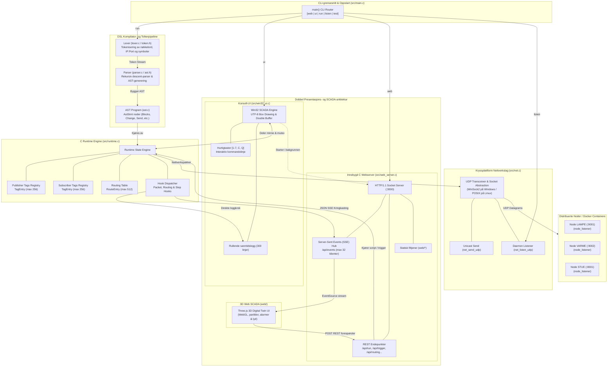
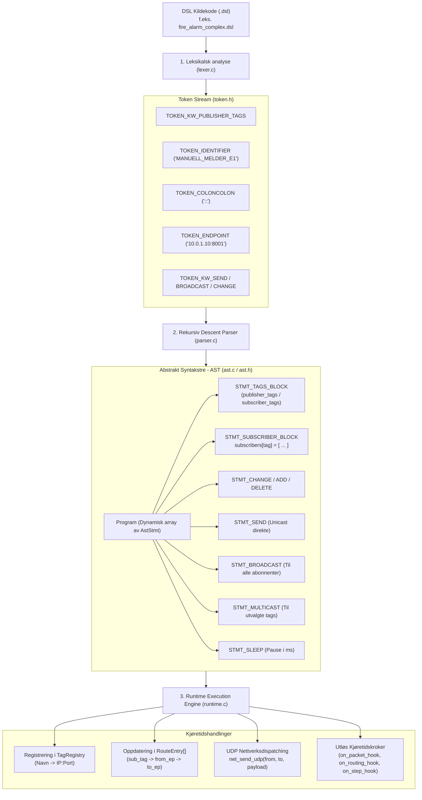
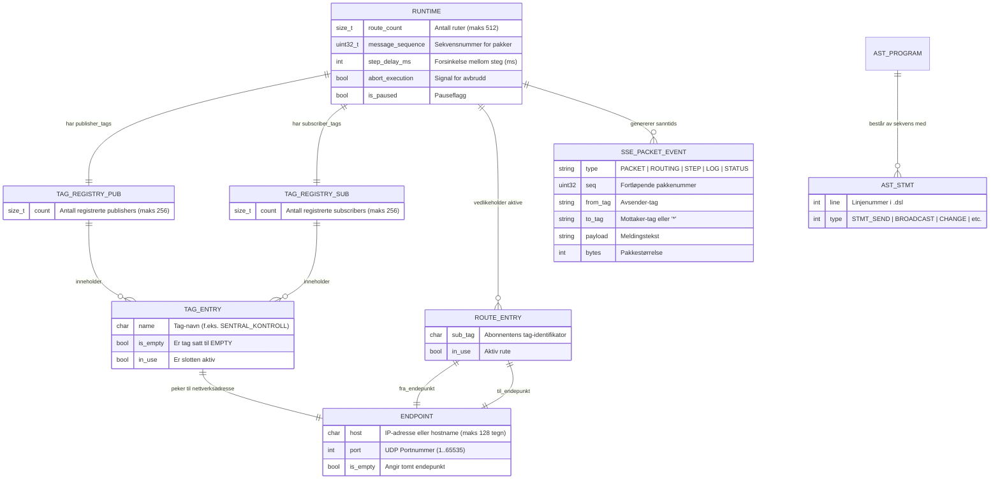
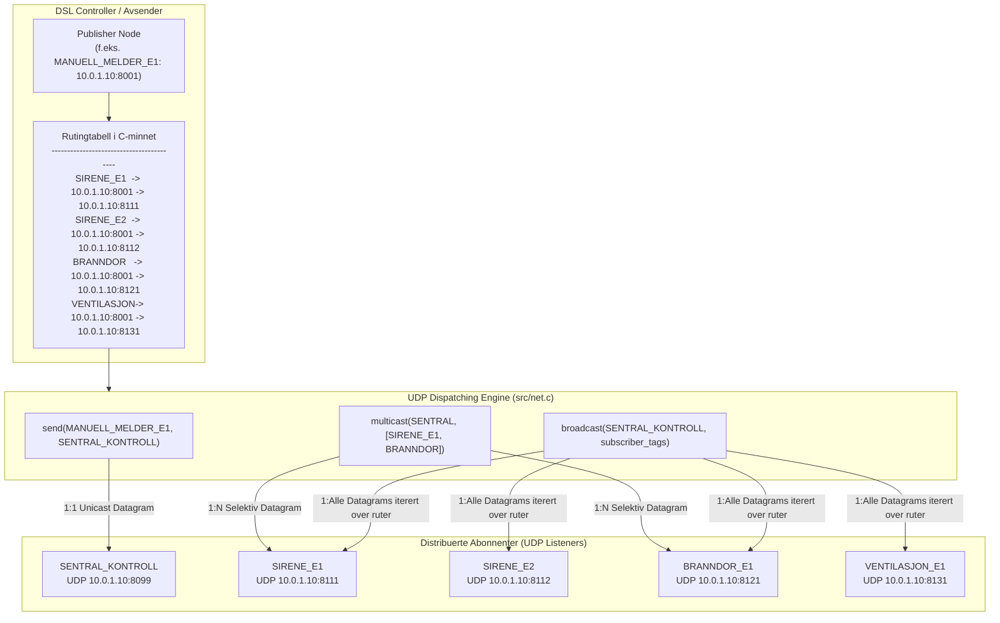
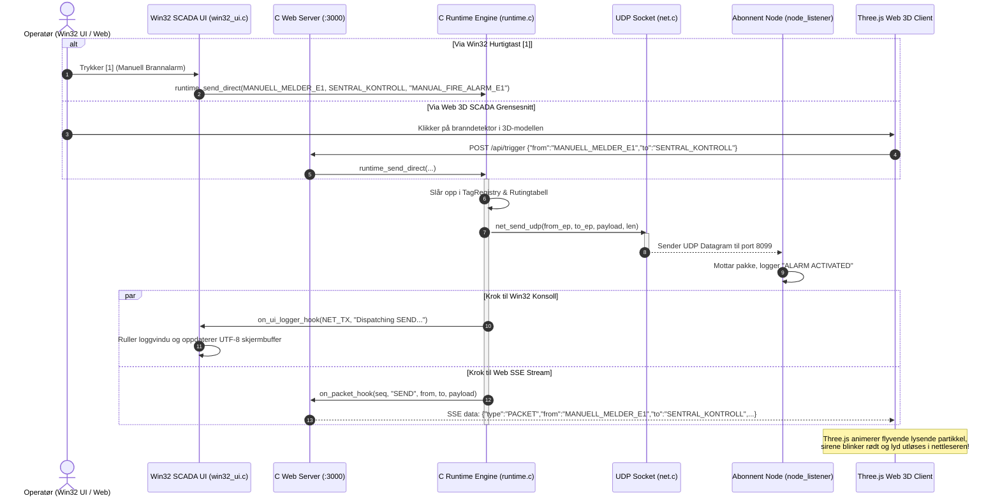
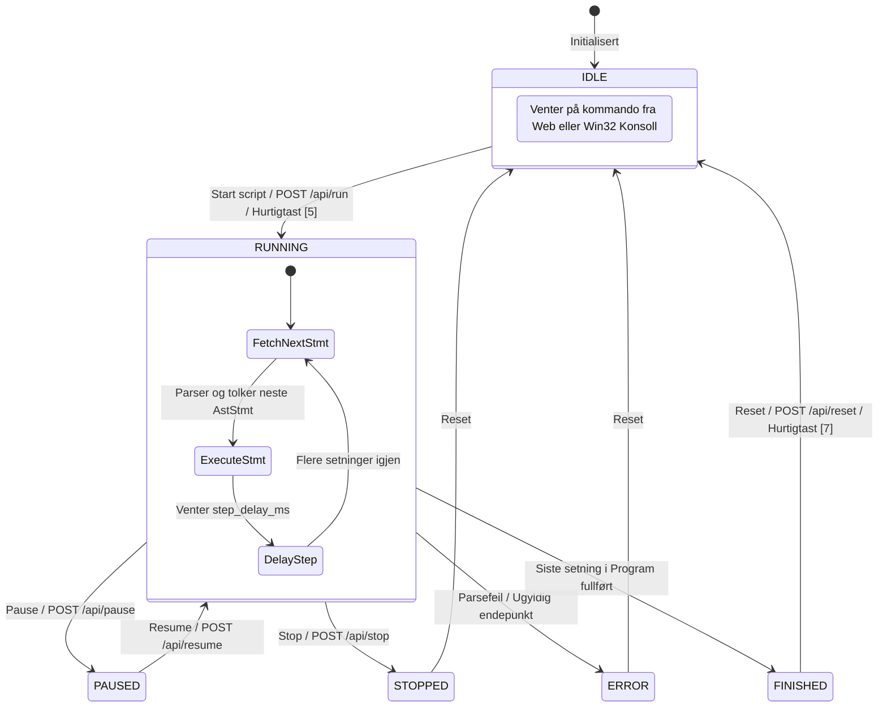
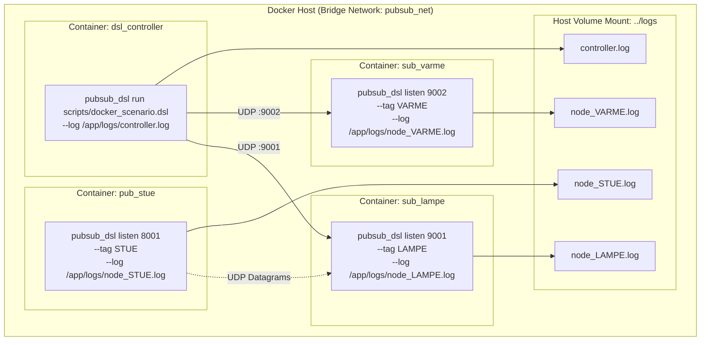

# PubSub DSL & Distribuert Kommunikasjonssystem i C

Dette prosjektet implementerer et fullstendig, skreddersydd programmeringsspråk (Domain-Specific Language - DSL) i C for pub/sub- og IoT-nettverksruting. Løsningen inkluderer en **native C-backend webserver med Three.js 3D SCADA-visualisering**, et **interaktivt Win32 SCADA konsoll-UI med sanntidslogg og full UTF-8-støtte**, samt et **komplett Docker-testoppsett** for verifisering av distribuert nettverkskommunikasjon.


---

## 📑 Innhold

1. [System- og Komponentarkitektur](#1-system--og-komponentarkitektur)
2. [DSL Kompilator- og Tolkerpipeline](#2-dsl-kompilator--og-tolkerpipeline)
3. [ER- og Minnemodell (C Datastrukturer)](#3-er--og-minnemodell-c-datastrukturer)
4. [Nettverks- og UDP-rutingstopologi](#4-nettverks--og-udp-rutingstopologi)
5. [Sekvensdiagram: Dual-UI & End-to-End Hendelsesflyt](#5-sekvensdiagram-dual-ui--end-to-end-hendelsesflyt)
6. [Tilstandsmaskin for Scenariokontroll](#6-tilstandsmaskin-for-scenariokontroll)
7. [Docker Distribuert Testarkitektur](#7-docker-distribuert-testarkitektur)
8. [Win32 SCADA Konsoll-UI (UTF-8)](#8-win32-scada-konsoll-ui-utf-8)
9. [Språksyntaks (DSL Spesifikasjon)](#9-språksyntaks-dsl-spesifikasjon)
10. [Three.js 3D SCADA Visualisering](#10-threejs-3d-scada-visualisering-en-54--nfpa-72)
11. [API-er, Endepunkter og Porter](#11-api-er-endepunkter-og-porter)
12. [Oppstart, Kjøring og Bygging](#12-oppstart-kjøring-og-bygging)

---

## 1. 🏗️ System- og Komponentarkitektur

Diagrammet viser hvordan C-kjernen, kompilatorpipelinen, nettverkslaget og de to samtidige brukergrensesnittene (Win32 Console og Web 3D) henger sammen:



---

## 2. ⚙️ DSL Kompilator- og Tolkerpipeline

Fra `.dsl`-kildefil parses til handlingene slår inn i nettverket og rutingtabellene:



---

## 3. 📊 ER- og Minnemodell (C Datastrukturer)

Systemets relasjonelle minnemodell for noder, ruter, meldinger og hendelser:



---

## 4. 🌐 Nettverks- og UDP-rutingstopologi

Rutingprinsippene i DSL-motoren: **Unicast**, **Multicast** og **Broadcast** via rutingtabellen:



---

## 5. 🔄 Sekvensdiagram: Dual-UI & End-to-End Hendelsesflyt

Sanntidsflyt ved operatørhandling i enten Win32-konsollen eller 3D Web UI:



---

## 6. 🚦 Tilstandsmaskin for Scenariokontroll

Styring av livssyklusen under kjøring av komplekse DSL-scenarier:



---

## 7. 🐳 Docker Distribuert Testarkitektur

Isolert flernode-testmiljø orkestrert med Docker Compose (`docker/docker-compose.yml`):



---

## 8. 💻 Win32 SCADA Konsoll-UI (UTF-8)

Prosjektet har et innebygd, profesjonelt **Win32 Konsoll SCADA-kontrollpanel** direkte i terminalen:

```
╔══════════════════════════════════════════════════════════════════════════════════════════════════╗
║   PUBSUB DSL - WIN32 SCADA KONTROLLPANEL & LOGG (UTF-8)       Port: 3000                         ║
║   Web: http://localhost:3000  • Status: AKTIV / KJØRER • Pakker: 24    • Noder: 11 pub / 14 sub  ║
╠══════════════════════════════════════════════════════════════════════════════════════════════════╣
║   SANNTIDSLOGG & HENDELSER (Viser siste 16 oppføringer)                                          ║
╟──────────────────────────────────────────────────────────────────────────────────────────────────╢
║ [21:07:17.274] INFO    [UI     ] PubSub DSL Win32 SCADA Kontrollpanel initialisert (UTF-8 aktiv) ║
║ [21:07:17.274] INFO    [WEB    ] C Web Backend listening on port 3000 (root: 'web')              ║
║ [21:07:18.102] ROUTING [ROUTING] Registered subscription route for 'SIRENE_E1': 10.0.1.10:8111...║
║ [21:07:22.450] NET_TX  [NET_TX ] Dispatching SEND from [MANUELL_MELDER_E1] to [SENTRAL_KONTROLL] ║
║ [21:07:22.451] INFO    [EXEC   ] Direct send from publisher [MANUELL_MELDER_E1] to [SENTRAL]    ║
║ [21:07:25.890] NET_TX  [NET_TX ] Dispatching BROADCAST from [SENTRAL_KONTROLL] to all sub tags   ║
╠══════════════════════════════════════════════════════════════════════════════════════════════════╣
║  HURTIGHANDLINGER / TESTBESKJEDER:                                                               ║
║   [1] Manuell Brannalarm (E1 -> Sentral)      [2] Kringkast Evakuering (Sentral -> Alle)         ║
║   [3] Røykvarsler Test (Resepsjon -> Sentral) [4] Send Egendefinert Beskjed (Fra/Til/Tekst)      ║
║   [5] Kjør Fullt DSL Brannalarm-Scenario      [6] Vis Routingtabell & Noder                      ║
║   [7] Nullstill Runtime (Reset)               [C] Tøm Logg          [Q] Avslutt                  ║
╠══════════════════════════════════════════════════════════════════════════════════════════════════╣
║  Status: Manuell brannalarm E1 utløst!                                                           ║
║  Kommando / hurtigtast [1-7, C, Q, help] >                                                       ║
╚══════════════════════════════════════════════════════════════════════════════════════════════════╝
```

### Funksjoner i Konsoll-UI:
1. **Full UTF-8 og Norske Tegn**:
   - Initialiserer Windows-konsollen med `SetConsoleOutputCP(CP_UTF8)` og `SetConsoleCP(CP_UTF8)`.
   - Norske tegn (`æ`, `ø`, `å`, `Æ`, `Ø`, `Å`) og Unicode-bokstegn (`╔═╗║╚╝`) vises feilfritt uten mojibake (`Kjører` og `Åpne` vises 100% riktig).
2. **Sanntidslogg i eget rullende vindu**:
   - Fanger automatisk opp logger fra alle C-tråder (webserver, scriptrunner, UDP-transceiver).
   - Fargekodede nivåer: `INFO` (grønn), `DEBUG` (cyan), `ROUTING` (magenta), `NET_TX` (blå), `WARN` (gul) og `ERROR` (rød).
3. **Hurtigtaster [1–7] for sending av meldinger**:
   - **`[1]`**: Manuell brannalarm (`MANUELL_MELDER_E1` → `SENTRAL_KONTROLL`).
   - **`[2]`**: Kringkasting (Broadcast evakueringsordre fra `SENTRAL_KONTROLL` til alle aktive noder).
   - **`[3]`**: Røykvarslertest (`ROYK_RESEPSJON` → `SENTRAL_KONTROLL`).
   - **`[4]`**: **Egendefinert beskjed**: Åpner en interaktiv prompt for å velge avsender-tag, mottaker-tag (eller `*` for broadcast) og meldingstekst.
   - **`[5]`**: Starter fullt EN 54 brannalarm DSL-scenario i bakgrunnen.
   - **`[6]`**: Dumper gjeldende routingtabell og noder direkte til loggvinduet.
   - **`[7]`**: Nullstiller runtime (`RESET`).
   - **`[C]`**: Tømmer loggvinduet.
   - **`[Q]`**: Avslutter serveren og UI-et rent.
4. **Interaktive tekstkommandoer**:
   Skriv direkte i kommandolinjen nederst:
   - `send <fra_tag> <til_tag> <beskjed>`
   - `broadcast <fra_tag> <beskjed>`
   - `run <script.dsl>`
   - `nodes` eller `routing`
   - `reset`, `clear`, `help`, `quit`
5. **2-Veis Sanntidssynkronisering med Three.js Web SCADA**:
   - Når du sender meldinger fra konsollen, dispatchers de i C-motoren, sendes over nettverket via UDP, og strømmes umiddelbart via SSE til Three.js-nettleservinduet.
   - Lysende nettverkspakker flyr i 3D-modellen, branndører lukkes og sirener blinker i synk!

---

## 9. 🚀 Språksyntaks (DSL Spesifikasjon)

Språket støtter alle spesifiserte IoT/SCADA-rutingstrukturer:

### 1. Blokk-deklarasjon av Tags
Definerer publisister og abonnenter med nettverksendepunkter (`ip:port`):
```dsl
publisher_tags:{
    STUE::192.168.1.10:8001 
    SOVEROM::192.168.1.11:8002
    SPISE::192.168.1.12:8003
}

subscriber_tags:{
    LAMPE::192.168.1.20:9001
    VARME::192.168.1.21:9002
}
```

### 2. Abonnent- og Rutingblokk (`subscribers[tag] = [ ... ]`)
```dsl
subscribers[LAMPE] = [
    # Registrerer abonnementsruting fra en publisher til subscriber
    subscribe(subscriber_tags, LAMPE):: 192.168.1.10:8001 -> 192.168.1.20:9001

    # Endrer adresse til en tag
    change(publisher_tags, STUE):: 192.168.1.10:8001 -> 192.168.1.99:8080

    # Setter en tag til EMPTY (deaktivert)
    change(publisher_tags, SPISE)::EMPTY

    # Legger til ny abonnent med adresse
    add(subscriber_tags, VIFTE):: 192.168.1.10:8001 -> 192.168.1.22:9003

    # Legger til ny abonnent uten adresse (medfører tag::EMPTY)
    add(subscriber_tags, RADIO)

    # Sletter en tag fullstendig fra registeret
    delete(subscriber_tags, VARME)
]
```

### 3. Kommunikasjonsinstruksjoner
Instruksjonene kan ta en valgfri meldingsstreng via `:: "melding"`:

- **Unicast (`send`)**:
  ```dsl
  send(STUE, LAMPE)
  send(STUE, LAMPE):: "Slå på lys i stua"
  ```

- **Multicast (`multicast`)**:
  Sender fra en spesifikk publisist-tag til en liste med abonnenter:
  ```dsl
  multicast(STUE, [LAMPE, VIFTE])
  multicast(STUE, [LAMPE, VIFTE]):: "Nattmodus aktivert"
  ```

- **Broadcast (`broadcast`)**:
  Sender fra spesifikk publisist til alle aktive abonnenter i `subscriber_tags` (hopper over noder merket som `EMPTY`):
  ```dsl
  broadcast(STUE, subscriber_tags)
  broadcast(STUE, subscriber_tags):: "Alarm: Bevegelse registrert!"
  ```

- **Tilleggsfunksjoner**:
  - `sleep(ms)`: Pause i skripteksekveringen (f.eks. `sleep(500)`)
  - `log("tekst")`: Loggfører egendefinert melding til konsoll og loggfil

---

## 10. 🔥 Three.js 3D SCADA Visualisering (EN 54 / NFPA 72)

Prosjektet inkluderer en fullverdig, interaktiv **Three.js 3D-visning og SCADA-kontrollpanel** drevet av den **native C-backend-serveren** (`http://localhost:3000`):

1. **Ren C Backend & DSL-motor (`src/web_server.c`, `src/runtime.c`)**:
   - All DSL-parsing (Lexer/AST/Parser) og eksekvering (Runtime, UDP-pakkeutsending, rutingstabellmutasjoner) skjer **utelukkende i C**.
   - C-webserveren strømmer hendelser, pakker, logger og steg direkte til nettleseren via **Server-Sent Events (SSE)** over `/api/events`.
   - Det finnes **ingen DSL-motor i JavaScript**; nettleseren fungerer som en ren 3D SCADA-klient og sender brukerkommandoer tilbake til C via REST API-et (`/api/run`, `/api/trigger`, `/api/routing`, `/api/reset`).
2. **Fysisk 3D-modell av industribygg (`web/js/building_3d.js`)**:
   - **Kjeller (Sone 0)**: Serverrom, serverrack med blinkende status-LED-er, Inergen (N2/Ar/CO2) inertgass-slukkesystem, VESDA aspirasjonsdetektor og teknisk rom.
   - **1. Etasje (Sone 1)**: Hovedinngang, resepsjon, kontorfløy, optiske røykdetektorer, manuelle meldere, optiske xenon-blitzlamper og **motoriserte branndører som fysisk lukkes**.
   - **2. Etasje (Sone 2)**: Storkjøkken med kokeøy, differensial-varmemelder, gassdetektor og **aktive vanntåke/sprinklerdyser som spyler vannpartikler**.
   - **Tak & HVAC (Sone 3)**: Motoriserte røykluker (`ROYKAVTREKK_TAK`) med roterende vifteblader, nødavstenging av ventilasjon (`HVAC_VENTILASJON_STOPP`) og heissjakt med nødretur.
3. **Visuelle partikkeleffekter og animasjoner**:
   - Reell røyk- og flammesimulering i berørte rom utløst av hendelser fra C-runtime.
   - Lysende nettverkspakker som sendes langs 3D-kabelgatene ved `send()`, `multicast()` og `broadcast()`.
   - Eksplodert visning (0–100% etasjeseparasjon) og X-Ray modus.
4. **Web Audio Synthesizer (`web/js/audio.js`)**:
   - Syntetiserer EN 54 Slow Whoop brannsirener (500–1200 Hz), gassutblåsingshves, vanndusj, dørklunk og talevarsling uten eksterne lydfiler.

---

## 11. 📡 API-er, Endepunkter og Porter

| Grensesnitt / Komponent | Protokoll / Type | Port / Rute | Formål |
| :--- | :--- | :--- | :--- |
| **Three.js Web UI** | HTTP GET | `:3000/` | Statisk Three.js SCADA 3D-grensesnitt |
| **Sanntids Hendelsesstrøm** | HTTP SSE (Server-Sent Events) | `:3000/api/events` | Strømmer `PACKET`, `ROUTING`, `STEP`, `LOG` til nettleser |
| **Kjør DSL Script** | HTTP POST | `:3000/api/run` | Kjører oversendt DSL-tekst i bakgrunnen |
| **Scenariokontroll** | HTTP POST | `:3000/api/pause`, `/resume`, `/stop`, `/reset` | Styrer tilstandsmaskinen for scriptkjøring |
| **Manuell Meldingstrigger** | HTTP POST | `:3000/api/trigger` | Sender enkeltbeskjed direkte fra webklienten |
| **Rutingtabell Dump** | HTTP GET | `:3000/api/routing` | Returnerer gjeldende rutingtabell og noder som JSON |
| **Scenario Kildekode** | HTTP GET | `:3000/api/scenario?file=...` | Henter `.dsl`-filer fra `scripts/` |
| **Win32 SCADA Panel** | Win32 Console API | Interaktiv konsoll | Farget terminalgrensesnitt med hurtigtaster `[1-7, C, Q]` |
| **UDP Daemon Listener** | UDP Datagrams | Konfigurerbar (f.eks. `:8001`, `:9001`) | Bakgrunnslytter for noder (mottar pakker og logger) |

---

## 12. 💻 Oppstart, Kjøring og Bygging

### Raskest: PowerShell-skript (Windows)
Kompilerer automatisk, åpner nettleseren på `http://localhost:3000` og starter det interaktive Win32 Konsoll-panelet:

```powershell
.\run_fire_alarm_web.ps1
```

### Direkte via Kommandolinjen
```bash
# Start Win32 SCADA Konsollpanel & Webserver på port 3000
.\pubsub_dsl.exe ui 3000
# eller
.\pubsub_dsl.exe web 3000

# Start kun webserver i bakgrunnen uten konsoll-UI (headless/daemon)
.\pubsub_dsl.exe web 3000 --no-ui

# Kjør et DSL-skript direkte i konsollen
.\pubsub_dsl.exe run scripts/fire_alarm_complex.dsl

# Kjør innebygde enhetstester
.\pubsub_dsl.exe test

# Start en frittstående abonnentnode-lytter
.\pubsub_dsl.exe listen 9110 --tag SIRENE_E1
```

### Docker Testmiljø
Docker-oppsettet oppretter et isolert nettverk (`pubsub_net`) med flere containere som kommuniserer over UDP via DNS-containernavn:
1. `sub_lampe`: Abonnentnode for tag `LAMPE` (port 9001)
2. `sub_varme`: Abonnentnode for tag `VARME` (port 9002)
3. `pub_stue`: Publisistnode for tag `STUE` (port 8001)
4. `dsl_controller`: Kjører DSL-tolkeren (`scripts/docker_scenario.dsl`) og orkestrerer testkommunikasjonen.

```powershell
# Kjøre testen via PowerShell:
.\run_docker_test.ps1

# Kjøre testen via Bash:
./run_docker_test.sh

# Eller direkte med docker compose:
docker compose -f docker/docker-compose.yml up --build --abort-on-container-exit
```

### Bygging fra Kildekode
```bash
# Windows (MinGW GCC):
gcc -Wall -Wextra -O2 -Isrc -o pubsub_dsl.exe src/*.c -lws2_32

# Linux / macOS:
gcc -Wall -Wextra -O2 -Isrc -o pubsub_dsl src/*.c -pthread
# eller:
make
```
